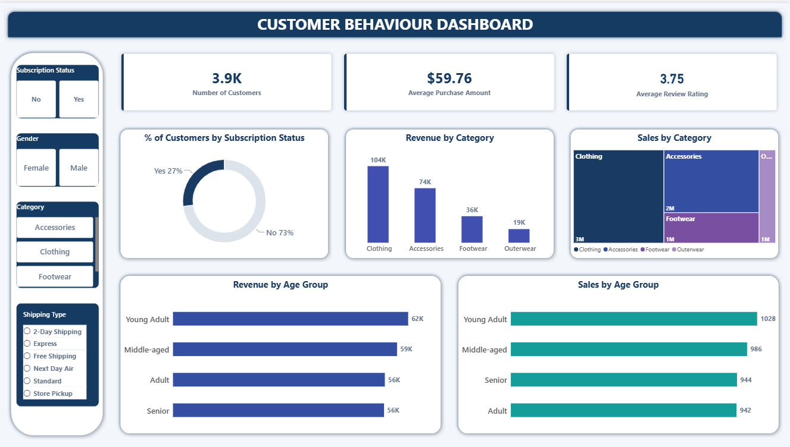

# Customer Behaviour Analysis

## Project Overview
This project analyzes customer purchasing behaviour using Excel, Python, SQL, and Power BI. The objective is to understand customer preferences, purchasing patterns, product performance, and revenue trends.

## Tools & Technologies
- **Excel:** Initial data exploration
- **Python:** Data cleaning and Exploratory Data Analysis (EDA)
- **SQL (SQL Server):** Business queries and customer analysis
- **Power BI:** Interactive dashboard and data visualization

## Project Workflow
1. Explored the dataset using Excel.
2. Performed data cleaning and EDA using Python.
3. Used SQL to answer business questions and analyze customer behaviour.
4. Created an interactive Power BI dashboard to visualize key metrics and trends.

## SQL Analysis
The analysis covers:
- Revenue by gender
- Discount usage and customer spending
- Top-rated products
- Standard vs Express shipping purchases
- Subscribers vs non-subscribers
- Product discount rates
- New, Returning, and Loyal customer segmentation
- Top-selling products by category
- Repeat buyers and subscription status
- Revenue contribution by age group

## Power BI Dashboard

## Project Files
- Python Jupyter Notebook
- SQL analysis queries
- Power BI dashboard (.pbix)
- Original dataset
- Dashboard screenshot

## Key Learnings
- Data exploration and cleaning
- Exploratory data analysis
- SQL querying and business analysis
- Data visualization and dashboard development
- Understanding customer purchasing patterns

## Conclusion
This project demonstrates an end-to-end data analysis workflow using Excel, Python, SQL, and Power BI to transform customer data into meaningful business insights.
